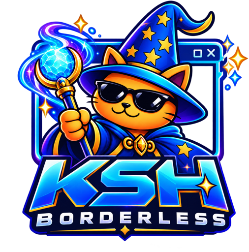

# KSH Borderless

**Graj w oknie bez ramki – w dokładnie takim rozmiarze, jakiego potrzebujesz.**

KSH Borderless ustawia gry i programy w oknie bez paska tytułu, w wybranym rozmiarze i miejscu na ekranie,
nad paskiem zadań Windows, i pilnuje, żeby myszka nie uciekała z okna gry.
Idealny do monitorów ultrawide i streamowania.

## Pobierz

👉 **[Najnowsza wersja – zakładka Releases](../../releases/latest)** → plik `kshborderless.exe`

Wymagania: Windows 10 / 11 (64-bit). Bez instalacji.

## Funkcje

- 🪟 **Okno bez ramki** – na streamie nie widać paska tytułu
- 📐 **Dowolny rozmiar i pozycja** – ręcznie albo z gotowych presetów pod stream (1080p, 720p, 1440p, pion 9:16)
- 🖱️ **Myszka zostaje w oknie gry**
- 📌 **Nad paskiem zadań**
- 🎮 **Profile gier** – gra ustawia się sama przy każdym uruchomieniu
- 🖥️ **Wiele monitorów**

## Jak zacząć

1. Pobierz `kshborderless.exe` i uruchom go.
2. Jeśli Windows pokaże ostrzeżenie: **„Więcej informacji” → „Uruchom mimo to”**.
3. Kliknij ikonkę przy zegarze i dodaj grę przyciskiem **„+ Z okien”** (gra musi być w trybie okna).

Szczegóły: [INSTRUKCJA.txt](INSTRUKCJA.txt)

## Licencja

Program jest darmowy – możesz go używać także na zarabiających streamach.
Nie wolno go sprzedawać ani udostępniać za opłatą. Logo i grafiki Kashello są zastrzeżone.
Szczegóły: [NOTICE.md](NOTICE.md) · [LICENSE.md](LICENSE.md)

---

**Kashello** · [Twitch](https://www.twitch.tv/kashelloo) · [YouTube](https://www.youtube.com/@Kashello) · [Discord](https://discord.gg/YgpYQg45Mp) · [kashello.pl](https://kashello.pl)
